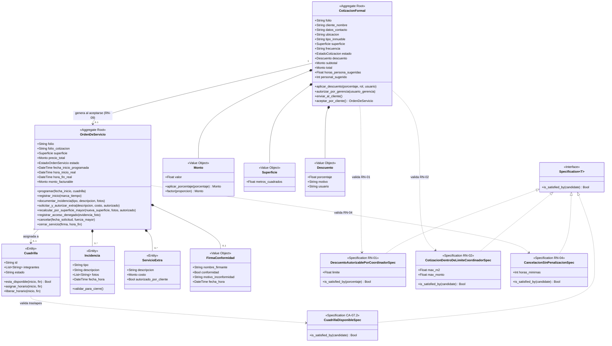
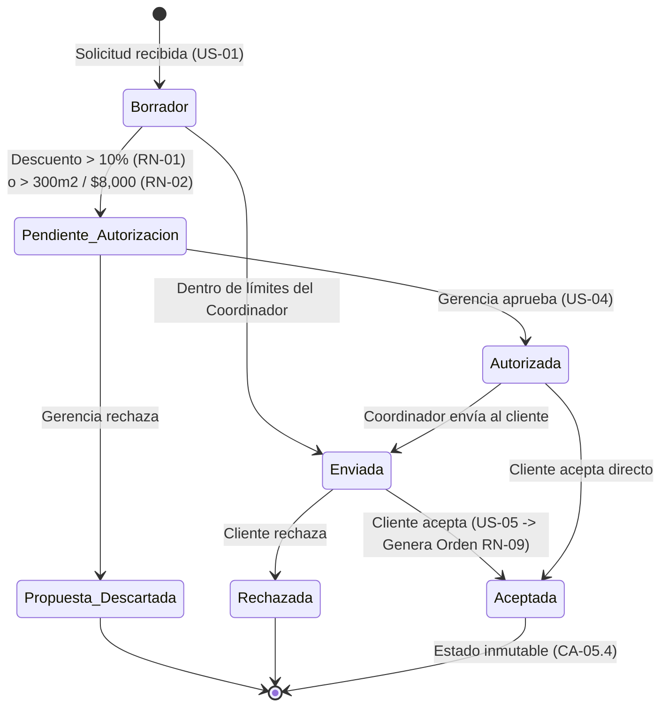
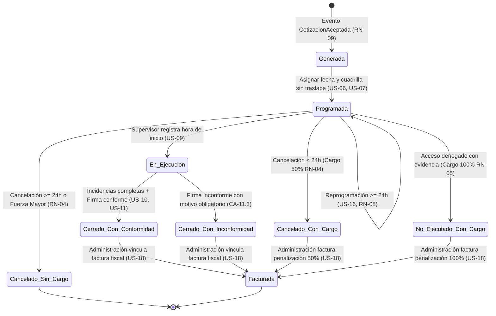
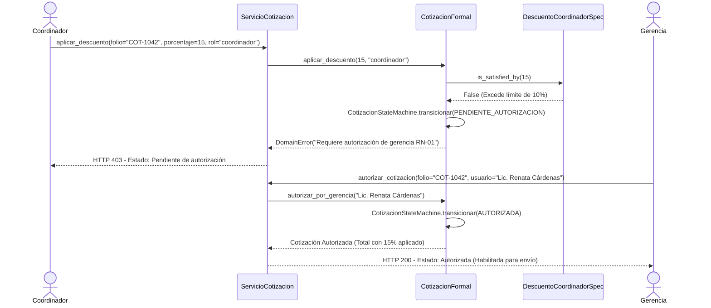
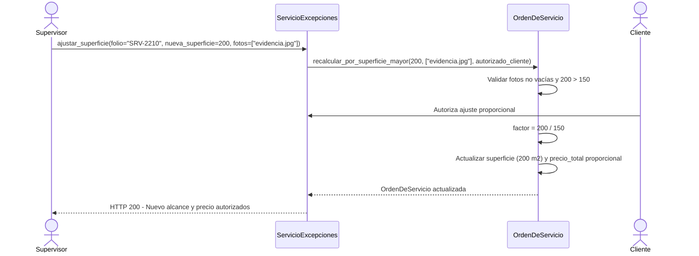
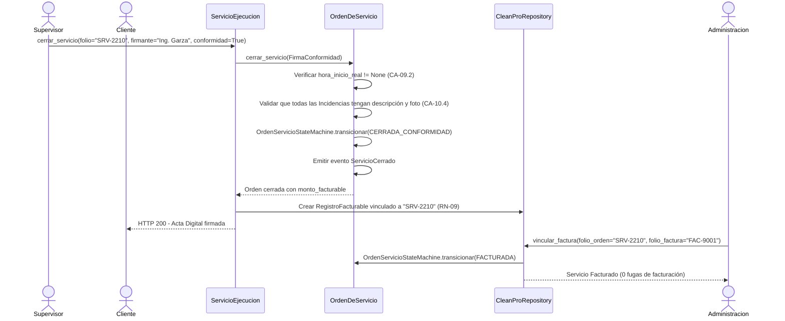

# Diagramas de Arquitectura, DDD y UML (Docs-as-Code)

Este documento concentra los diagramas arquitectónicos del sistema **CleanPro** en formato **Mermaid** (renderizables nativamente en GitHub) y su correspondencia con los archivos interactivos de Draw.io incluidos en el repositorio (`BPMN CleanPro.html`, `diagrama_de_clases_uml.html` y `Diagrama secuencia 1.html`).

---

## 1. Diagrama de Clases del Dominio (DDD + Specification + State Machine)

Representa las Raíces de Agregado (`CotizacionFormal`, `OrdenDeServicio`), Entidades (`Cuadrilla`, `Incidencia`, `ServicioExtra`), Objetos de Valor (`Monto`, `Superficie`, `Descuento`, `FirmaConformidad`), Máquinas de Estado y Especificaciones.

---

## 2. Diagramas de Máquina de Estados (State Machine Pattern)

### 2.1 Máquina de Estados de `CotizacionFormal`
Modela las reglas **RN-01**, **RN-02** y los criterios **CA-03.2**, **CA-04.2**, **CA-05.3** y **CA-05.4**.

### 2.2 Máquina de Estados de `OrdenDeServicio`
Modela las reglas **RN-04**, **RN-05**, **RN-09** y los criterios **CA-06.1**, **CA-09.2**, **CA-10.4**, **CA-11.2**, **CA-13.3**, **CA-16.2** y **CA-18.1**.

---

## 3. Diagramas de Secuencia de Casos de Uso Críticos

### 3.1 Secuencia 1: Descuento Mayor al 10% y Autorización de Gerencia (US-03, US-04, RN-01)

### 3.2 Secuencia 2: Ajuste de Superficie Mayor en Sitio con Evidencia (US-15, RN-07)

### 3.3 Secuencia 3: Cierre de Servicio con Firma Digital y Vinculación a Facturación (US-10, US-11, US-18, RN-09)

---

## 4. Trazabilidad del Modelo BPMN (`BPMN CleanPro.html`)

El diagrama BPMN completo del repositorio modela el proceso *Gestión Integral de Limpieza CleanPro (AS-IS Optimizado)* distribuido en **5 Swimlanes (Participantes)** y **6 Data Objects**:

1. **Carril Cliente:** Evento de inicio por mensaje (*Solicitud de cotización Web/WhatsApp/Tel*) -> *Revisar y responder cotización (US-05)* -> Gateway exclusivo de aceptación -> *Autorizar/Rechazar extra o mayor superficie (US-14, US-15)* -> *Firmar conformidad digital (US-11)*.
2. **Carril Coordinador:** *Capturar datos y sugerir recursos (US-01, US-02)* -> Gateway `¿>10% desc. o >300m2 / $8,000? (RN-01, RN-02)` -> *Emitir y enviar cotización (<4h RN-03)* -> *Programar fecha y asignar cuadrilla (US-06, US-07)* -> Gateway `¿Cancelación previa? (US-16, RN-04)` -> *Cotizar extra o recálculo en sitio (US-14, US-15)*.
3. **Carril Gerencia (Lic. Renata Cárdenas):** *Evaluar excepción de precio/dimensión (US-04)* -> Gateway de aprobación o descarte de propuesta.
4. **Carril Supervisor / Cuadrilla:** *Consultar agenda y presentarse en sitio (US-08)* -> *Reportar ausencia y sustitución (US-12)* -> Gateway `¿Permite acceso? (RN-05)` -> *Registrar acceso denegado (US-13)* o *Registrar hora de inicio (US-09)* -> Gateway `¿Extra o mayor superficie? (RN-06, RN-07)` -> *Ejecutar limpieza y documentar incidencias (US-10)* -> *Registrar hora fin y resumen digital (US-09, US-11)*.
5. **Carril Administración:** *Facturar penalización 50% (RN-04)* / *Facturar penalización 100% (RN-05)* / *Aplicar cambios directos a nómina (US-17)* / *Emitir factura vinculada al servicio cerrado (US-18, RN-09)* -> *Generar tablero mensual de KPIs (US-19)* -> Evento de fin *Servicio Facturado y Cerrado*.
6. **Data Objects Modelados:** `[DO1] Solicitud Cotización`, `[DO2] Cotización Formal`, `[DO3] Orden de Servicio`, `[DO4] Registro Nómina`, `[DO5] Acta Digital + Fotos`, `[DO6] Factura Fiscal`.